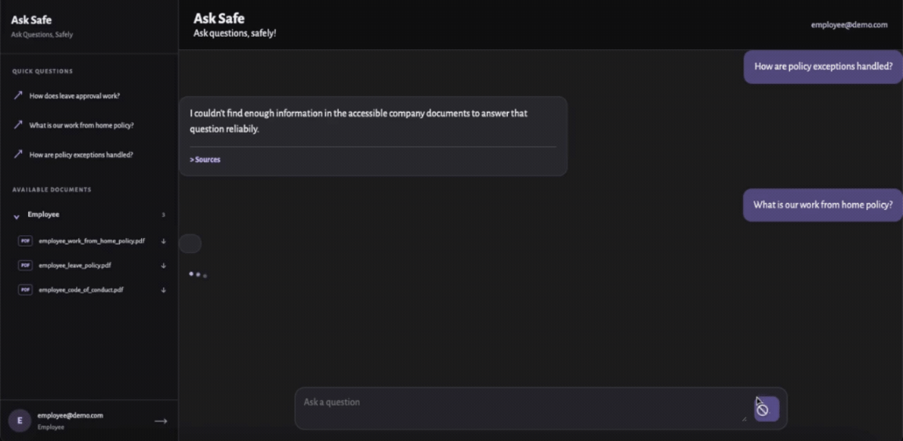
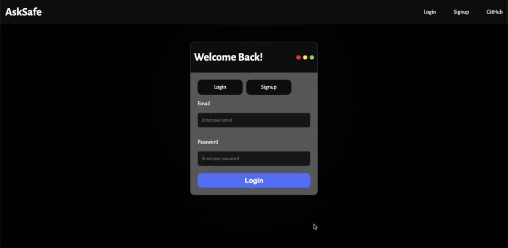
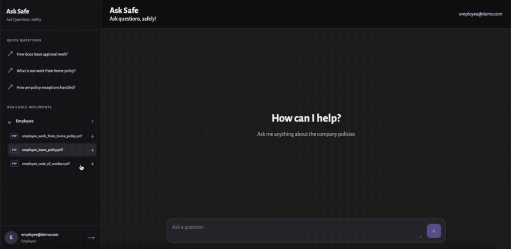
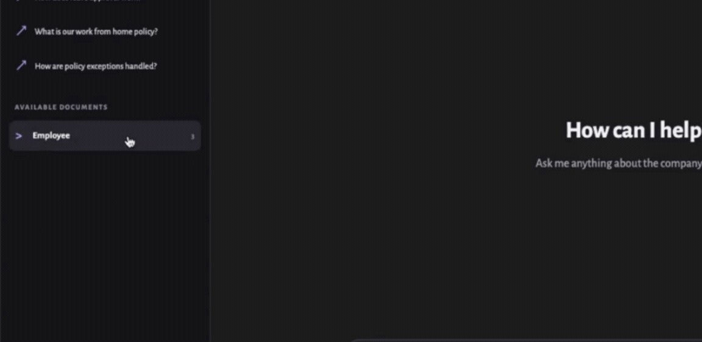
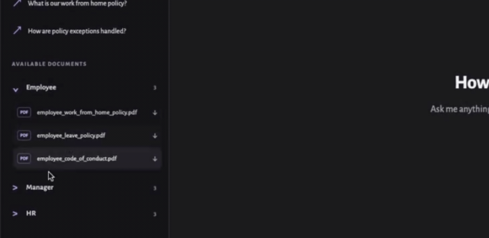
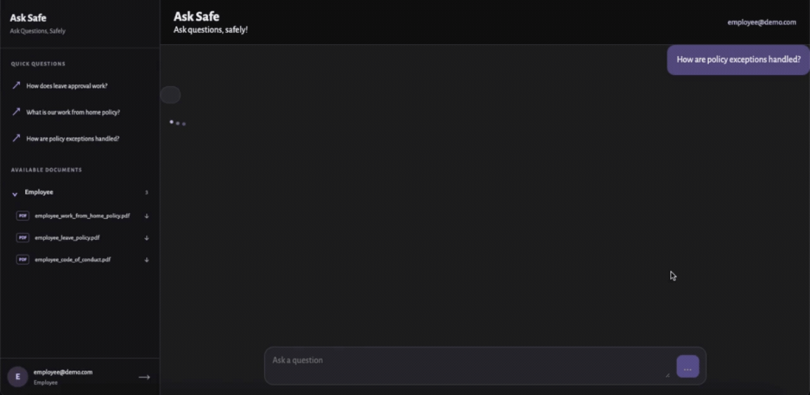
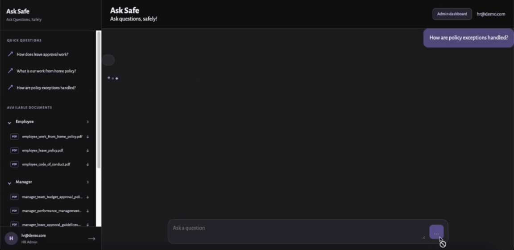
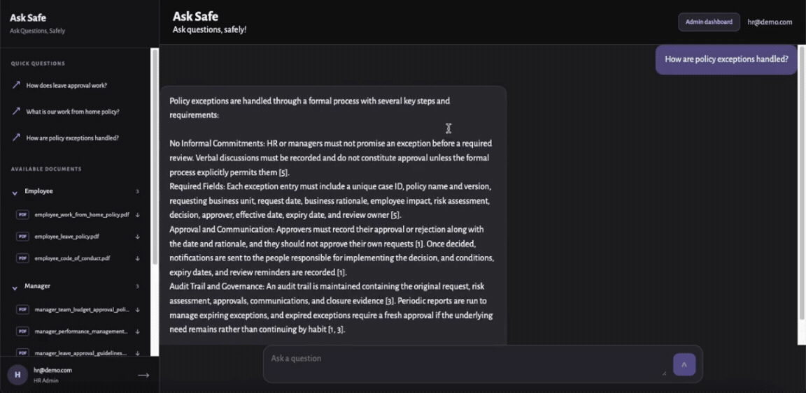
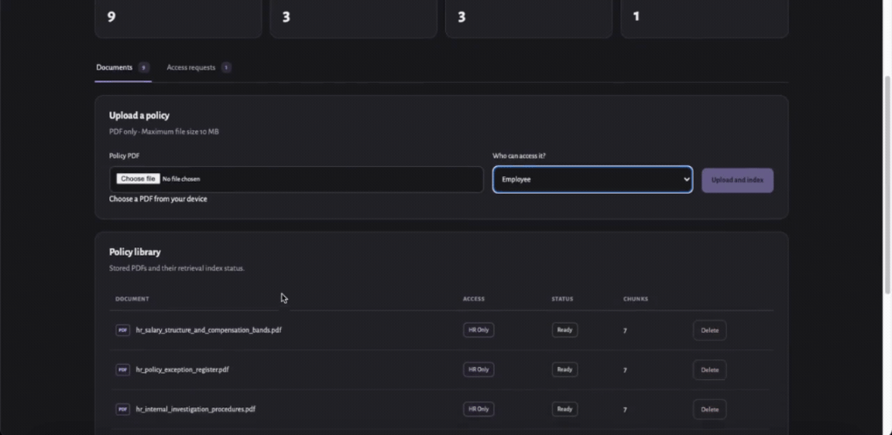
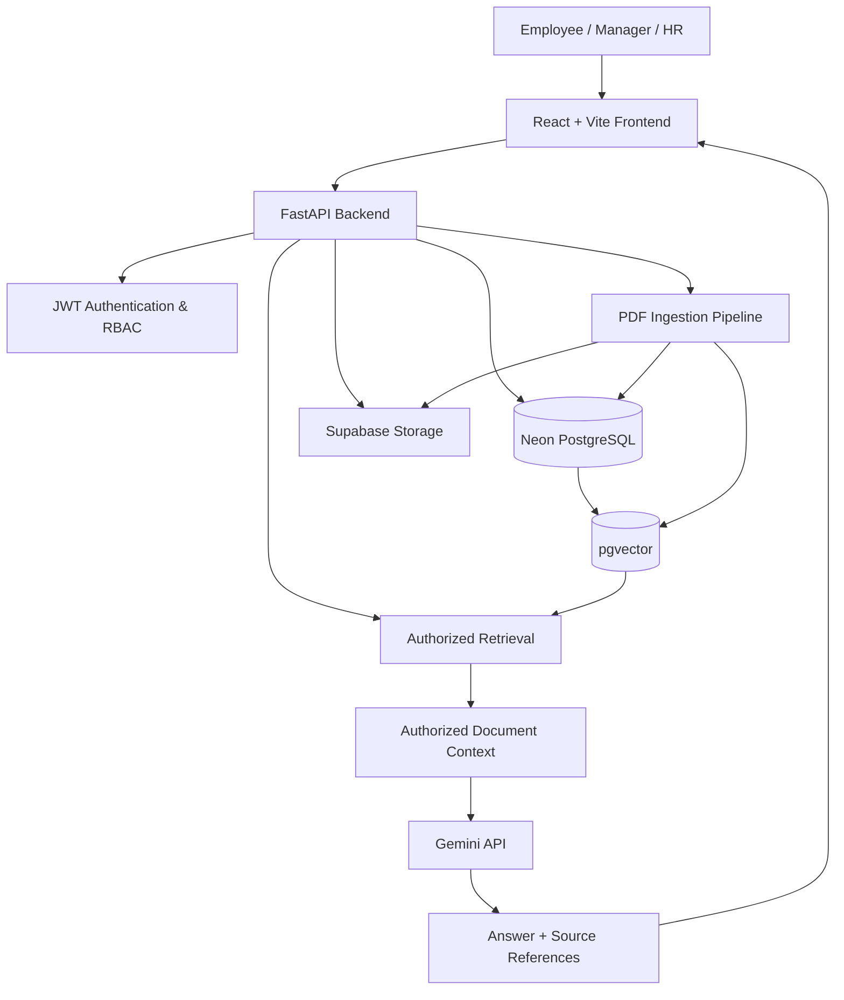

# Ask Safe — Secure Enterprise Policy Copilot

Ask Safe is an AI-powered enterprise policy assistant that lets employees ask questions about internal company documents and receive context-aware answers with source references. It combines Retrieval-Augmented Generation (RAG) with server-side Role-Based Access Control (RBAC) to ensure that answers are grounded in documents the requesting user is authorized to access.

Unlike a generic PDF chatbot, Ask Safe treats document authorization as a core part of the retrieval pipeline. The backend filters accessible documents before their contents are passed to the language model.

The result is a conversational interface for company policies, backed by a permission-aware retrieval system.

## Features

### 1. Role-Based Authentication

Create an account as an **employee**, **manager**, or **HR administrator**, then sign in to access the appropriate workspace.

Employee accounts become active upon signup. Manager and HR administrator accounts require approval before they can access their respective privileges.

### 2. Access the Documents You Need

Browse available policy documents, inspect their access categories, and download authorized PDFs directly from the sidebar.

Documents are stored separately from their metadata and searchable representations, allowing Ask Safe to manage original files alongside the retrieval pipeline.

### 3. One Workspace, Different Permissions

All users don't see the same collection of documents. Ask Safe adapts the available policy library to the authenticated user's role.

<table>
  <tr>
    <th align="center">Employee View</th>
    <th align="center">HR Administrator View</th>
  </tr>
  <tr>
    <td align="center"></td>
    <td align="center"></td>
  </tr>
  
</table>

The sidebar provides a convenient view of accessible documents, but the actual permission checks happen on the backend. Hiding a document in the UI is not the security mechanism.

### 4. Same Question. Different Authorization. Different Answer.

This is the core of Ask Safe.

A question about confidential HR information should not produce the same result for every user. The backend retrieves only the document chunks permitted for the requesting role before sending context to Gemini.

<table>
  <tr>
    <th align="center">Employee — Access Denied by the Application</th>
    <th align="center">HR Administrator — Authorized Answer</th>
  </tr>
  <tr>
    <td align="center"></td>
    <td align="center"></td>
  </tr>
  <tr>
    <td align="center">The assistant cannot find sufficient authorized evidence to answer.</td>
    <td align="center">The assistant answers using the authorized HR context.</td>
  </tr>
</table>

The important distinction is that this is not merely a prompt telling the AI to keep secrets. The application enforces access restrictions before constructing the model's context.

### 5. Admin page to Add, View and Delete Documents

HR administrators can manage the policy library through a dedicated dashboard.

- Upload PDF policy documents and assign their access level.
- View document metadata, processing status, and chunk counts.
- Delete documents from the policy library.
- Refresh and inspect the current document inventory.

### 6. And to approve new users

Privileged access should not be granted just because someone selects a role during signup.

Manager and HR administrator registrations remain pending until an HR administrator approves or rejects the request. The backend uses the account status and authenticated role to control access to protected functionality.

---

## Technicalities

### 1. Authorization Model

Ask Safe uses three application roles with a hierarchical document-access policy.

| User role | Accessible document categories | Signup and access rules |
|---|---|---|
| Employee | Employee | Account activated upon signup |
| Manager | Employee + Manager | Requires HR approval |
| HR Administrator | Employee + Manager + HR | Requires HR approval |

This hierarchy determines which document chunks may enter a user's retrieval context. The same authorization rules also govern protected document downloads and administrative actions.

The role hierarchy is an application policy, not a claim that managers automatically have access to every kind of employee information. Documents are assigned explicit access categories, and backend authorization determines what can be retrieved.

### 2. High-Level Architecture

Ask Safe consists of a React frontend, a FastAPI backend, persistent data stores, and an external language model.

#### Technology Stack

| Layer | Technologies | Purpose |
|---|---|---|
| Frontend | React, JavaScript, Vite, CSS | Chat interface, document sidebar, and admin dashboard |
| Backend | Python, FastAPI | API endpoints, orchestration, authorization, and ingestion |
| Authentication | JWT, FastAPI dependencies | Authenticated requests and protected routes |
| Database | Neon PostgreSQL, SQLAlchemy | Users, documents, metadata, and persistent application records |
| Vector search | pgvector | Storing and searching document embeddings |
| File storage | Supabase Storage | Persistent storage for original PDF documents |
| Language model | Google Gemini API | Generating answers grounded in retrieved context |

### 3. The Retrieval-Augmented Generation Pipeline

Ask Safe uses RAG to answer questions from internal policy documents instead of relying solely on the language model's pretrained knowledge.

**Document ingestion**

1. An authorized HR administrator uploads a PDF.
2. The backend validates the file and extracts its text and page information.
3. The extracted content is split into smaller chunks.
4. Embeddings are generated and stored for semantic retrieval.
5. Document metadata and chunk records are persisted, while the original PDF is stored in Supabase Storage.

**Question answering**

1. The user submits a question with an authenticated request.
2. The backend identifies the user's role and determines the permitted document categories.
3. Retrieval searches the authorized document scope for relevant chunks.
4. Only the retrieved, authorized context is sent to Gemini.
5. The generated response is returned with relevant source references when available.
6. If sufficient authorized evidence is unavailable, the assistant communicates that limitation instead of inventing a policy answer.

### 4. Engineering Decisions Worth Highlighting

**Server-enforced authorization before LLM context construction**

The backend applies role-based restrictions before retrieved document content is sent to Gemini. The frontend is not trusted to enforce confidentiality.

**Separation of original documents and searchable data**

PDF files live in Supabase Storage, while PostgreSQL maintains document metadata and pgvector-backed retrieval data. This separates file persistence from the data used for semantic search.

**Grounded answers with source references**

The assistant is designed to answer from retrieved policy context and identify supporting documents and pages when available. Insufficient authorized evidence should result in a clear limitation rather than an unsupported answer.

**Controlled account activation**

Privileged roles require an approval workflow. The backend checks both authentication and authorization before allowing access to administrative operations.

**Streaming responses**

The application supports a streaming query endpoint that can deliver answer content incrementally, along with source information and completion or error events, improving the conversational experience.

### 5. Security and Reliability Considerations

Ask Safe's design emphasizes explicit authorization checks, protected API endpoints, authenticated document downloads, and evidence-grounded answers.

The security boundary is the backend: a client must not be able to gain access merely by changing its interface state or submitting a different role value.

As with any RAG system, generated answers and citations require testing. Retrieval quality, incomplete source context, model availability, and failures during ingestion can all affect the final result. These are important considerations when extending the application beyond its current scope.

---

## Why Ask Safe?

Ask Safe demonstrates how an AI application can combine conversational interfaces with practical backend engineering.

It brings together API design, authentication, authorization, relational and vector databases, document processing, cloud file storage, LLM integration, and a role-aware administrative workflow in one application.

The central idea is simple: **an AI assistant should answer from information the user is allowed to access, not merely information the system happens to possess.**

### Setup Locally
Use this comprehensive guide to configure the project and Locally and run it
